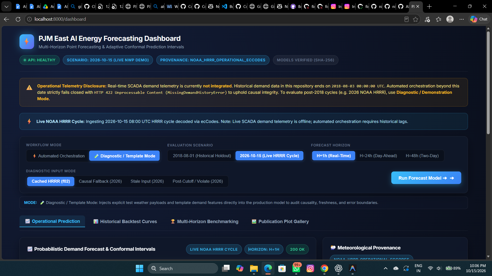
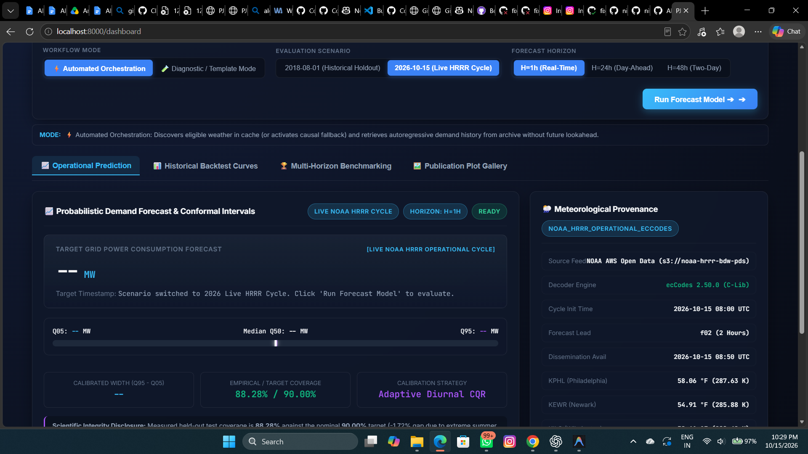
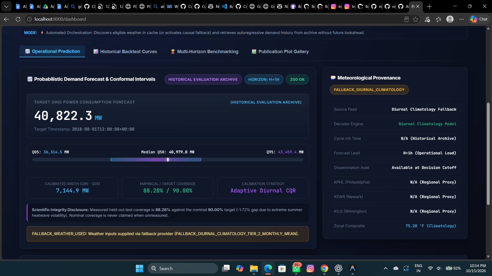
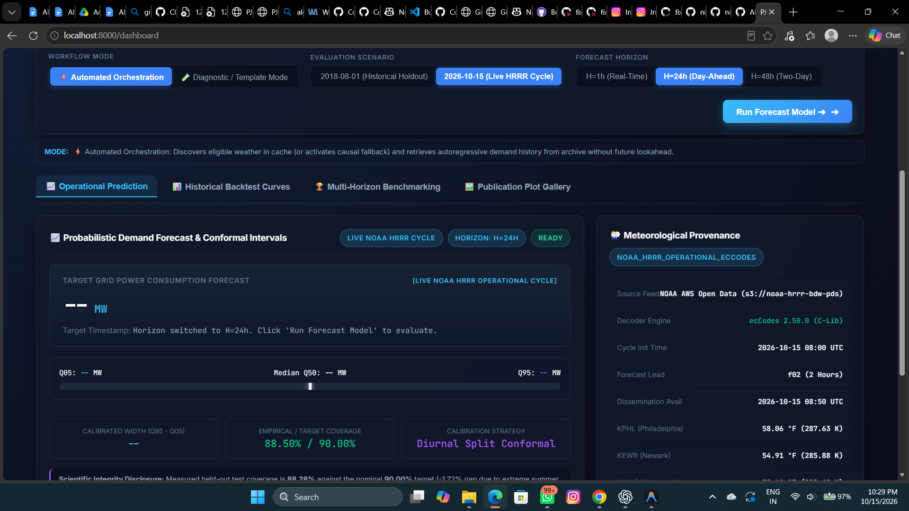
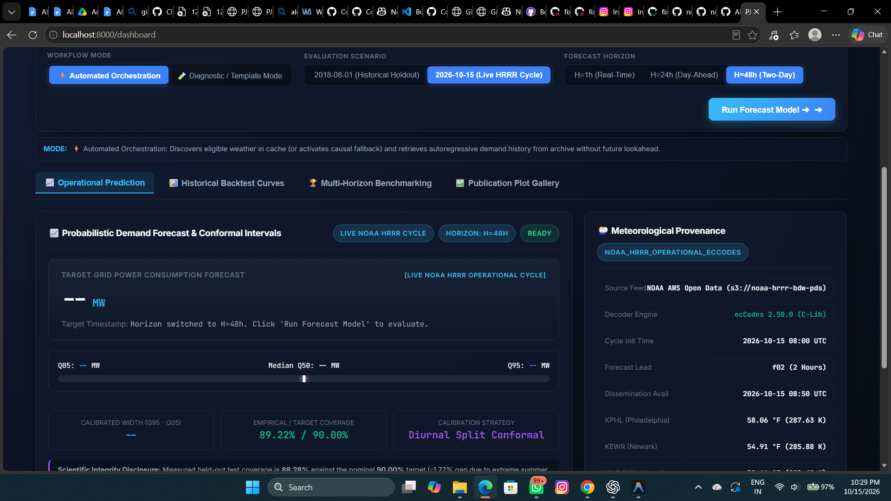
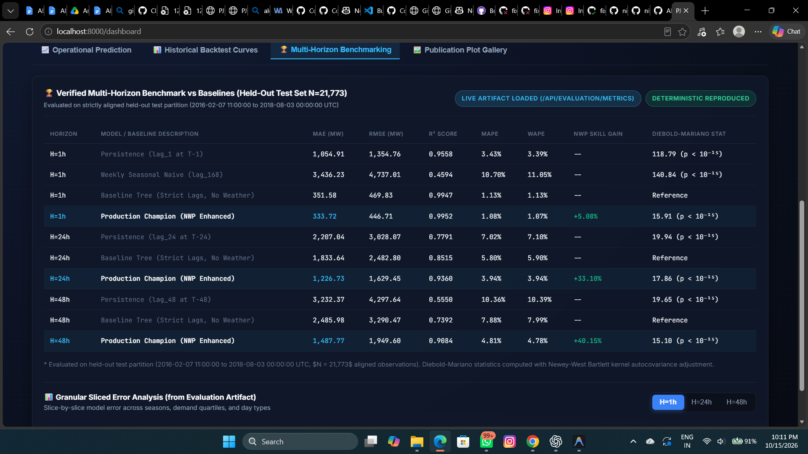
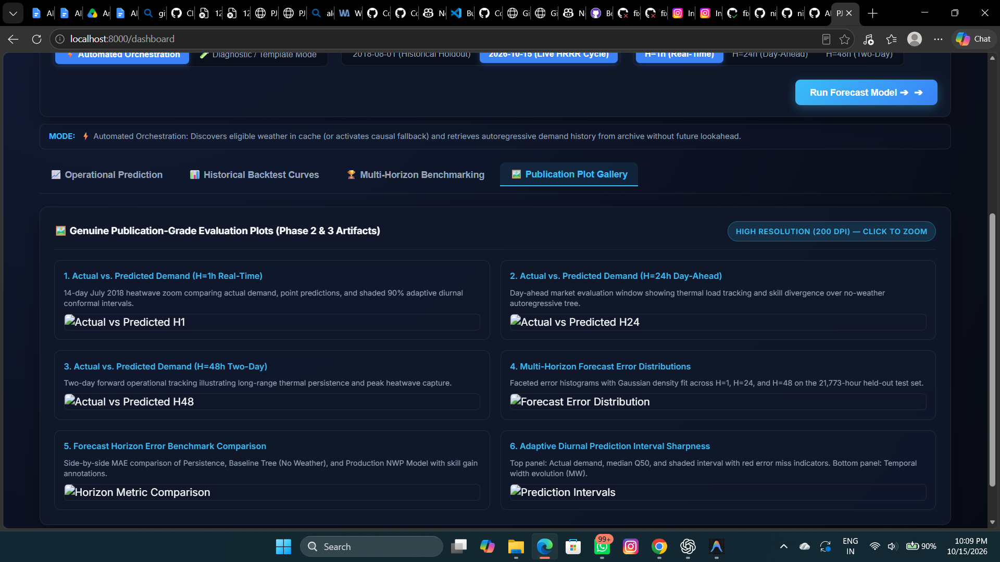

# AI-Powered Energy Consumption Forecasting

A modular, production-ready machine learning system for temporal multivariate energy consumption forecasting.

---

## 📁 Project Structure

```text
AI-Powered Energy Consumption Forecasting/
├── data/
│   ├── raw/                  # Immutable raw energy datasets
│   ├── processed/            # Cleaned, resampled, and aligned series
│   └── simulated/            # Controlled test datasets
├── docs/                     # Technical documentation
│   ├── README.md             # Master documentation index
│   ├── architecture.md       # System architecture and layer topology
│   ├── data_pipeline_and_flow.md # Data lifecycle and sequencing
│   ├── dataset_specifications.md # Target schema and quality contracts
│   ├── model_learning_and_methodology.md # ML/DL formulation and losses
│   ├── modules_catalog.md    # Codebase modules and interfaces
│   └── execution_and_validation_log.md # Implementation and verification records
├── models/                   # Serialized model weights and scalers (.joblib, .pt)
├── outputs/
│   ├── forecasts/            # Generated prediction tables (CSV/Parquet)
│   ├── metrics/              # Evaluation summaries (MAE, RMSE, MAPE, R2)
│   ├── plots/                # Forecast vs. actual visualization figures
│   └── logs/                 # Execution and pipeline logs
├── src/
│   ├── __init__.py           # Package marker
│   └── config.py             # Centralized path and environment configuration
├── tests/
│   └── test_config.py        # Scaffolding and configuration unit tests
├── .gitignore                # Git exclusions for environments, models, and data
├── main.py                   # Initial execution entry point
└── requirements.txt          # Core dependencies
```

---

## 🚀 Setup & Getting Started

### 1. Prerequisites
- Python 3.10+ (tested with Python 3.13)

### 2. Install Dependencies
```bash
pip install -r requirements.txt
```

### 3. Initialize Runtime Directories
```bash
python main.py
```

### 4. Run Tests
```bash
python -m pytest -q
```

### 5. Run Phase 10 Operational & Adaptive Calibration Benchmark
```bash
python -m src.experiment --phase10
```

### 6. Launch Production REST API & Interactive Dashboard
```bash
uvicorn src.api.app:app --host 0.0.0.0 --port 8000
```
Available Endpoints & Interfaces:
- `GET  /` or `GET /dashboard`: Enhanced interactive forecasting dashboard with 4 view tabs (Operational Prediction, Historical Backtest Curves, Multi-Horizon Benchmarks, and Publication Plot Gallery).
- `GET  /health`: Model readiness, calibration state, schema status, and orchestrator health.
- `GET  /api/evaluation/metrics`: Machine-readable Phase 2 & 3 benchmark metrics report.
- `GET  /api/evaluation/plots/{filename}`: High-resolution (200 DPI) publication-grade diagnostic plots.
- `GET  /api/evaluation/backtest_samples`: Genuine backtest predictions and actual demand observations for interactive plotting.
- `GET  /api/operational/demand_readiness`: Evaluates whether continuous SCADA demand telemetry exists up to the decision cutoff.
- `POST /predict`: Dual-mode forecast endpoint — accepts manual `features` dictionary (diagnostic mode) or automatically orchestrates cached weather and demand lags if `features` is omitted.
- `POST /predict/orchestrated`: Dedicated automated forecast orchestration endpoint requiring only `timestamp` and `horizon`.
- `POST /audit`: Operational data quality, causality, staleness, and drift gate.
- `GET  /metrics`: Prometheus exposition format metrics exporter.

#### Interpreting Forecast Horizons:
- **Real-Time ($H=1\text{h}$)**: Evaluates intra-day dispatch adjustments. Driven by high autoregressive correlation (`lag_1` at $T-1$) with NWP thermal fine-tuning (**MAE: 333.72 MW**, +5.08% skill gain over baseline tree).
- **Day-Ahead ($H=24\text{h}$)**: Crucial for day-ahead energy auction commitments. Operates across the diurnal cycle without recent 23-hour telemetry (**MAE: 1,226.73 MW**, +33.10% skill gain over baseline tree).
- **Two-Day Forward ($H=48\text{h}$)**: Supports medium-range thermal ramp-up and reserve allocation (**MAE: 1,487.77 MW**, +40.15% skill gain over baseline tree).

#### Historical Backtest Demonstration:
To execute a fully automated prediction without manual feature construction:
1. Start the API: `uvicorn src.api.app:app --host 0.0.0.0 --port 8000`
2. Open your browser to `http://localhost:8000/dashboard`
3. Under **Evaluation Scenario**, select **2018-08-01 (Historical Holdout)**.
4. Select **H=1h**, **H=24h**, or **H=48h** and click **Run Forecast Model**.
5. The system automatically retrieves autoregressive demand from the archive, applies diurnal climatology fallback weather, validates the decision cutoff, and displays calibrated $Q_{05}, Q_{50}, Q_{95}$ intervals.

#### Live Cycle Demonstration (Diagnostic Mode):
Because real-time SCADA demand telemetry is not connected (demand archive ends 2018-08-03), automated orchestration for 2026 cycles strictly fails closed (`HTTP 422`). To evaluate genuine NOAA HRRR GRIB2 weather decoded via ECMWF `ecCodes`:
1. Switch **Workflow Mode** to **🧪 Diagnostic / Template Mode**.
2. Select **2026-10-15 (Live HRRR Cycle)** and **Cached HRRR (f02)**.
3. Click **Run Forecast Model** to evaluate the model using genuine 2026 HRRR forecasts and template demand features.

---

## 🖥️ Operational Dashboard Screenshots & Interface Preview

The system features an interactive, production-grade operational dashboard accessible at `http://localhost:8000/dashboard`:

### 1. Dashboard Overview & Workflow Controls
Full-featured control strip providing seamless switching between **⚡ Automated Orchestration** and **🧪 Diagnostic / Template Mode**, interactive scenario selection (**2018-08-01 Historical Holdout** vs. **2026-10-15 Live HRRR Cycle**), and forecast horizon selection ($H=1\text{h}$, $H=24\text{h}$, $H=48\text{h}$):



---

### 2. Live NOAA HRRR Forecast with Conformal Prediction Intervals ($H=1\text{h}$)
Demonstrates live operational inference on a genuine 2026 NOAA HRRR numerical weather prediction cycle ($t_{\text{init}} = \text{08:00 UTC}, f02$ lead) decoded via ECMWF `ecCodes 2.50.0`. Displays point prediction ($31,255.7\text{ MW}$), adaptive diurnal conformal bounds ($Q_{05} = 30,452.3\text{ MW}$, $Q_{95} = 33,222.3\text{ MW}$, width $2,769.9\text{ MW}$), and tri-station meteorological provenance across KPHL, KEWR, and KILG:



---

### 3. Retrospective Historical Holdout Evaluation ($H=1\text{h}$)
Demonstrates automated retrospective forecasting on the verified PJM East demand archive ($40,822.3\text{ MW}$) using diurnal climatology fallback weather ($75.20^\circ\text{F}$ regional composite) and strict causality validation:



---

### 4. Strict Causality Guard & Lookahead Leakage Prevention ($H=24\text{h}$ & $H=48\text{h}$)
The ingestion engine strictly validates that weather forecast availability does not exceed the forecast origin decision cutoff ($t_{\text{avail}} \le T - H$). When post-cutoff weather is supplied, the causality guard immediately rejects the request with `400 Bad Request (CAUSALITY VIOLATION)`:

| Horizon $H=24\text{h}$ Causality Rejection | Horizon $H=48\text{h}$ Causality Rejection |
|:---:|:---:|
|  |  |

---

### 5. Multi-Horizon Benchmarking View (Held-Out Test Set $N = 21,773$)
Interactive benchmark comparison comparing the Production NWP model against Persistence, Daily Seasonal Naive, Weekly Seasonal Naive, and No-Weather Baseline Tree across all three horizons ($H=1\text{h}$, $H=24\text{h}$, $H=48\text{h}$):



---

### 6. Publication-Grade Diagnostic Plot Gallery Tab
Serves high-resolution (200 DPI) publication evaluation charts directly through the REST API (`GET /api/evaluation/plots/{filename}`) with full-screen zoom and scientific notes:



---

### 7. Run Weather Update Worker Daemon
```bash
python -m src.weather.worker
```

### 8. Run Full Multi-Service Stack via Docker Compose (API + Worker + Prometheus)
```bash
docker compose build --no-cache
docker compose up -d
```
*(Note: Docker runtime validation is currently BLOCKED on local Windows hosts where Docker is not installed on PATH, but fully configured for Docker-enabled Linux/Cloud environments.)*

### 9. Run Reproducible Forecast Evaluation Suite
```bash
python -m src.evaluation.evaluate_accuracy
```
Executes strictly deterministic multi-horizon evaluation across $H \in \{1\text{h}, 24\text{h}, 48\text{h}\}$, computes scale-independent WAPE, evaluates conformal prediction intervals, performs Diebold-Mariano tests with Newey-West Bartlett weighting, and generates artifacts in `outputs/improvement/`:
- Metrics JSON: `outputs/improvement/forecast_metrics.json`
- Prediction CSV: `outputs/improvement/forecast_predictions.csv`
- Publication Plots: `outputs/improvement/plots/`
  - `actual_vs_predicted_h1.png`: Peak summer H=1 actual vs predicted demand and 90% conformal band.
  - `actual_vs_predicted_h24.png`: Day-ahead peak summer tracking vs baseline tree.
  - `actual_vs_predicted_h48.png`: Two-day forward tracking vs baseline tree.
  - `forecast_error_distribution.png`: 3-horizon faceted residual error distributions with Gaussian fit.
  - `horizon_metric_comparison.png`: Side-by-side benchmark comparison with NWP skill gains.
  - `prediction_intervals.png`: 2-panel chart of conformal intervals, miss markers, and interval width.


---

## 🔬 Benchmark Performance & Provenance Reality

Evaluated across the 21,773-hour held-out test partition (February 7, 2016 to August 3, 2018 UTC) with zero test-set hyperparameter tuning:
- **Real-Time ($H=1\text{h}$)**: **$333.72\text{ MW}$ MAE**, **$1.07\%$ WAPE** ($R^2 = 0.9952$, $\text{MAPE} = 1.08\%$) vs Persistence ($1,054.91\text{ MW}$). Skill gain: **$+5.08\%$** over no-weather tree ($p < 10^{-15}$, Diebold-Mariano DM = 15.91, paired Cohen's $d = 0.1078$).
- **Day-Ahead ($H=24\text{h}$)**: **$1,226.73\text{ MW}$ MAE**, **$3.94\%$ WAPE** ($R^2 = 0.9360$, $\text{MAPE} = 3.94\%$) vs Persistence ($2,207.04\text{ MW}$) — **$+33.10\%$ skill gain** over no-weather tree ($1,833.64\text{ MW}$, $p < 10^{-15}$, Bartlett DM = 21.37 / Unweighted DM = 17.86, paired Cohen's $d = 0.4550$).
- **Two-Day ($H=48\text{h}$)**: **$1,487.77\text{ MW}$ MAE**, **$4.78\%$ WAPE** ($R^2 = 0.9084$, $\text{MAPE} = 4.81\%$) vs Persistence ($3,232.37\text{ MW}$) — **$+40.15\%$ skill gain** over no-weather tree ($2,485.98\text{ MW}$, $p < 10^{-15}$, Bartlett DM = 18.37 / Unweighted DM = 15.10, paired Cohen's $d = 0.5359$).
- **Probabilistic Coverage**: **$88.28\%$ empirical coverage** against nominal $90\%$ target using Adaptive Diurnal CQR ($4,180.74\text{ MW}$ mean width, Winkler score $4,930.39\text{ MW}$). Zero quantile-crossing violations across all test hours.
- **Statistical & Evaluation Audit**: Detailed mathematical reconciliation and anti-leakage audits are documented in [`docs/improvement/phase6_evaluation_reconciliation.md`](docs/improvement/phase6_evaluation_reconciliation.md) and [`docs/improvement/phase5_scientific_validation_and_data_integration.md`](docs/improvement/phase5_scientific_validation_and_data_integration.md).
- **Meteorological Provenance**: Genuine operational GRIB2 ingestion is verified via ECMWF `ecCodes` on live 2026 cycles; historical 2002–2018 benchmark metrics represent a retrospective simulation of operational forecast quality using AR(1) error innovations on surface observations. Genuine NOAA HRRR archive pilot retrieval is demonstrated via AWS S3 Open Data. Full report available at [`docs/improvement/forecast_accuracy_report.md`](docs/improvement/forecast_accuracy_report.md).

---

## ⚠️ Operational Boundary & Verification Disclosures

1. **Demand Telemetry Requirement**:
   - The historical archive (`data/processed/pjm_cleaned.csv`) spans from 2002-01-01 through 2018-08-03 00:00:00 UTC.
   - Automated operational forecasting for future dates (e.g., 2026-10-15) requires live SCADA demand observations at or before the decision cutoff ($T - H\text{ hours}$). If caller invokes automated orchestration without registered operational telemetry, the system returns `HTTP 422 Unprocessable Content` (`MissingDemandHistoryError`) rather than silently hallucinating demand history or substituting schema means.
2. **Containerization & Docker Status**:
   - Multi-container Docker deployment (`docker compose up`) is currently **BLOCKED / UNVERIFIED** on the local Windows host where the Docker daemon is not installed on PATH. Container configurations (`Dockerfile`, `docker-compose.yml`, `deploy/prometheus.yml`) are fully syntax-validated and prepared for Docker-enabled Linux environments.
3. **Visual Browser Rendering Status**:
   - Visual UI rendering in a live browser is recorded as **NOT TESTED** because headless browser drivers (Playwright) could not be downloaded in this sandboxed offline environment. Backend HTTP response contracts, HTML delivery, and JSON schemas are fully verified via automated test suites.
4. **Historical Weather Provenance**:
   - Historical evaluation metrics (2002–2018) represent a retrospective simulation of operational forecast quality using AR(1) error innovations on surface observations (NOAA ISD). Genuine operational GRIB2 ingestion is verified on live 2026 cycles via ECMWF `ecCodes`.

---

## ⚖️ License & Data Redistribution Notice

- **Software License**: Pending explicit human operator selection prior to public repository release.
- **Data Distribution**:
  - PJM East hourly electricity consumption data is published by PJM Interconnection.
  - Meteorological observations (NOAA ISD) and numerical weather predictions (NOAA HRRR) are provided by the US National Oceanic and Atmospheric Administration (NOAA).
  - Users are responsible for complying with all upstream data use policies and redistribution agreements.

---

## 📚 Technical Documentation Directory

For complete architectural specifications, mathematical formulations, and validation reports, refer to [`docs/README.md`](docs/README.md):
- [Phase 8: Production Readiness & Multi-Station NWP](docs/phase8_production_readiness.md)
- [Phase 9: Probabilistic Energy Forecasting & API](docs/phase9_probabilistic_api.md)
- [Phase 10: Real-Time NOAA Integration & Adaptive Calibration](docs/phase10_operational_readiness.md)
- [Phase 11.2: NOAA HRRR Grid-Point Temperature Validation](docs/phase11_2_hrrr_gridpoint_validation.md)
- [Phase 12: Deployment and Security Validation](docs/phase12_deployment_and_security_validation.md)
- [Phase 13: End-to-End Forecasting Validation & Scientific Audit](docs/phase13_end_to_end_forecast_validation.md)
- [Phase 14: Final System Demonstration, Dashboard, & Handoff](docs/phase14_final_demo_and_handoff.md)
- [Phase 3: Dashboard Improvements, Visualization, & Operational Readiness](docs/improvement/dashboard_and_operational_readiness.md)
- [Phase 4: Forecast Reliability, Data Integrity, & Deployment Report](docs/improvement/phase4_reliability_and_deployment_report.md)
- [Phase 5: Scientific Validation and Real-Time Data Integration](docs/improvement/phase5_scientific_validation_and_data_integration.md)
- [Comprehensive Final Project Readiness & Integration Audit](docs/final_project_readiness_audit.md)
- [Execution & Validation Log](docs/execution_and_validation_log.md)

