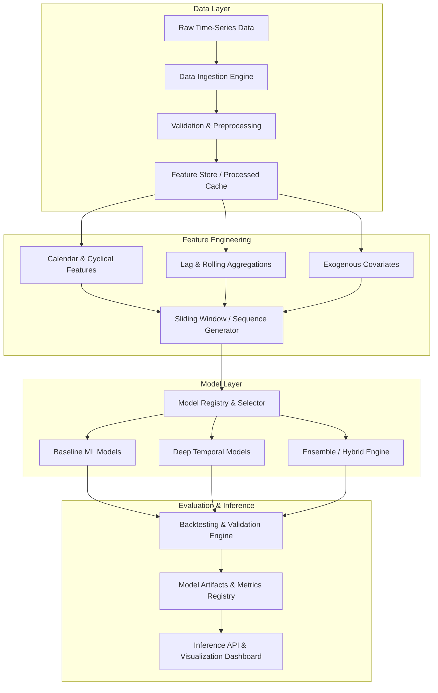

# System Architecture

## 1. System Overview

The **AI-Powered Energy Consumption Forecasting** platform is designed as a modular, production-ready machine learning system tailored for temporal multivariate energy consumption prediction. It spans raw ingestion to inference, monitoring, and interactive visualization.

---

## 2. Architectural Layers

### 2.1 Ingestion & Preprocessing Layer
- **Responsibility**: Ingest raw data streams or batch CSV/Parquet files, rectify sampling frequency (imputation/resampling), detect anomalies/outliers, and validate strict schema bounds.
- **Key Pattern**: Pipeline-based transformation with immutable raw data retention.

### 2.2 Feature Engineering Layer
- **Temporal Decompositions**: Trend, seasonality (hourly, daily, weekly, yearly).
- **Cyclical Encoding**: Sine/Cosine transforms for periodic variables (hour of day, day of week, month).
- **Auto-regressive Lags**: Historical load values ($t-1, t-2, \dots, t-k$) and windowed rolling statistics (moving average, exponential moving average, rolling standard deviation).
- **Exogenous Integration**: Temperature, humidity, solar irradiance, holiday flags.

### 2.3 Model Layer
- **Dual Pipeline Strategy**:
  1. *Tabular/Tree-based Stack*: LightGBM / XGBoost / CatBoost for high-efficiency short-horizon forecasts and feature importance attribution.
  2. *Deep Sequence Stack*: LSTM / GRU / Temporal Fusion Transformer (TFT) or Temporal Convolutional Networks (TCN) for multi-step ahead sequence-to-sequence forecasting.
- **Model Registry**: Standardized interfaces (`fit`, `predict`, `evaluate`, `save`, `load`).

### 2.4 Validation & Inference Layer
- **Temporal Cross-Validation**: Expanding-window and rolling-window backtesting to prevent data leakage.
- **Serving & Presentation**: Clean API endpoints and an interactive frontend dashboard for visual analysis of forecast vs. actuals, confidence intervals, and consumption trends.
