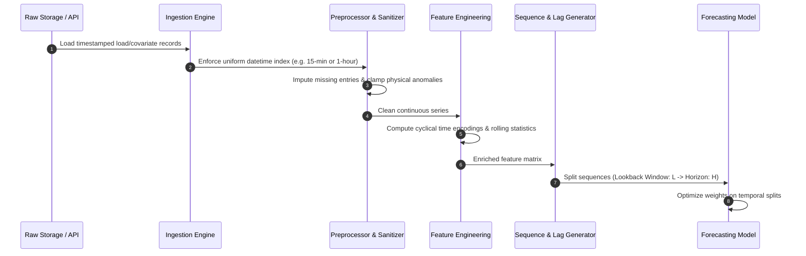

# Data Pipeline & Flow Specifications

## 1. End-to-End Data Flow

The lifecycle of energy data traverses distinct deterministic stages to eliminate temporal lookahead bias and ensure production reproducibility.

---

## 2. Pipeline Stages

### 2.1 Implemented Data Ingestion & Sanitization Engine (`src.data`)

The Phase 2 ingestion engine implements explicit, deterministic data preparation:

1. **Loader (`load_energy_data`)**:
   - Resolves timestamp aliases (`timestamp`, `datetime`, `date`, `time`) and consumption aliases (`consumption`, `consumption_mw`, `pjme_mw`, `power`) case-insensitively.
   - Normalizes target columns to `timestamp` and `consumption`.
   - Coerces invalid timestamps to `NaT` and invalid consumption strings to `NaN` without silent row drops.
   - Raises `FileNotFoundError` for missing files and `ValueError` for empty datasets or ambiguous column matches.

2. **Validator (`validate_energy_data`)**:
   - Evaluates row counts, missing timestamps, missing consumption values, duplicate timestamps, monotonic ordering, and physical bounds.
   - Detects temporal gaps when `expected_frequency` (e.g., `'h'`) is supplied; does not assert gaps when omitted.
   - Categorizes negative consumption as a configurable warning (`allow_negative_consumption=True`) or error (`allow_negative_consumption=False`).
   - Does not modify or drop rows.

3. **Preprocessor (`preprocess_energy_data`)**:
   - Operates on a deep copy without mutating input DataFrames.
   - Enforces configurable duplicate policies: `'keep_first'`, `'keep_last'`, or `'error'`.
   - Never performs silent zero-fills, implicit interpolations, or scaler transformations.
   - Provides an audit trail via `CleaningReport` tracking counts for each removal reason.
   - Sorts records chronologically.

4. **Persistence (`save_cleaned_data`)**:
   - Persists cleaned data to `PROCESSED_DATA_DIR / "energy_cleaned.csv"` or explicit destination.
   - Includes safety checks refusing to overwrite raw data paths (`DEFAULT_DATA_PATH`).

### 2.2 Quality Contracts & Limitations
- **Current Scope**: Implemented for single-series univariate consumption with temporal index. Exogenous multi-variable merging will be connected in feature engineering phases.
- **Missing Value Policy**: Gaps and missing values are reported in audit logs. Automated imputation is deferred to feature modeling to prevent lookahead data leakage.

### 2.3 Implemented Temporal Feature Engineering (`src.features.temporal_features`)

The feature pipeline transforms timestamp and consumption into leakage-safe tabular predictors:

1. **Calendar Features**:
   - `hour` (0–23), `day_of_week` (0=Monday, 6=Sunday), `day_of_month` (1–31), `month` (1–12), `is_weekend` (1 for Sat/Sun, 0 for weekdays).
2. **Cyclical Encodings**:
   - Trigonometric transformations preserving cyclical continuity across midnight and week boundaries:
     $$\text{hour\_sin} = \sin\left(\frac{2\pi \cdot \text{hour}}{24}\right), \quad \text{hour\_cos} = \cos\left(\frac{2\pi \cdot \text{hour}}{24}\right)$$
     $$\text{day\_of\_week\_sin} = \sin\left(\frac{2\pi \cdot \text{dow}}{7}\right), \quad \text{day\_of\_week\_cos} = \cos\left(\frac{2\pi \cdot \text{dow}}{7}\right)$$
3. **Autoregressive Lags**:
   - Configurable positive integer lag offsets (default: 1, 24, 168):
     $$\text{lag}_k[t] = \text{consumption}[t - k]$$
4. **Rolling Statistics & Anti-Leakage Rules**:
   - Rolling mean and standard deviation over past observations (default: 24h window):
     $$\text{rolling\_mean}_w[t] = \frac{1}{w} \sum_{i=0}^{w-1} \text{consumption}[t - i]$$
   - **Leakage Prevention Contract**: For row $t$ with forecast origin $t$ and target at $t+1$, all rolling statistics strictly span $[t - w + 1, t]$. Any change to future consumption observations at $t+1, t+2, \dots$ has zero mathematical effect on row $t$'s features.
5. **Target Alignment**:
   - Feature row timestamp: $t$ (forecast origin).
   - Target timestamp: $t+1$ (`target_timestamp = timestamp.shift(-1)`).
   - Target consumption: $C_{t+1}$ (`target_next_hour = consumption.shift(-1)`).
   - The final observation row has target `NaN` (unobserved future).
6. **Gap-Handling Policy**:
   - When `expected_frequency` (e.g., `'h'`) is supplied, irregular intervals or missing timestamp steps immediately raise a `ValueError` rather than silently compressing disconnected hours into adjacent rows. When omitted, no frequency regularity is asserted.

### 2.4 Implemented Sliding-Window Sequence Generator (`src.features.sequence_builder`)

For sequential and recurrent deep architectures, `build_sliding_windows()` creates structured 3D tensors:
- **Tensors Produced**:
  - $\mathbf{X} \in \mathbb{R}^{M \times L \times D}$ where $M$ is sample count, $L$ is sequence length (default 168), and $D$ is feature count.
  - $\mathbf{y} \in \mathbb{R}^{M}$ (for horizon=1) or $\mathbb{R}^{M \times H}$ (for multi-step horizon $H$).
- **Anti-Leakage Alignment**:
  For window $i$, input $\mathbf{X}[i]$ contains time steps $[i, i+1, \dots, i+L-1]$. The target $\mathbf{y}[i]$ contains step(s) $[i+L, \dots, i+L+H-1]$.
  The target observation is strictly in the future of the input window.
- **Timestamp Tracking**: Returns `window_end_timestamps` (forecast origin) and `target_timestamps` in the immutable `SequenceDataset` container.

### 2.5 Current Limitations
- **No External Holiday Calendars**: Country-specific holidays are not yet injected to avoid external unpinned package dependencies.
- **Strict Regularity Requirement**: When `expected_frequency` is active, datasets with gaps must be resampled or continuous segments extracted before sequence generation.
