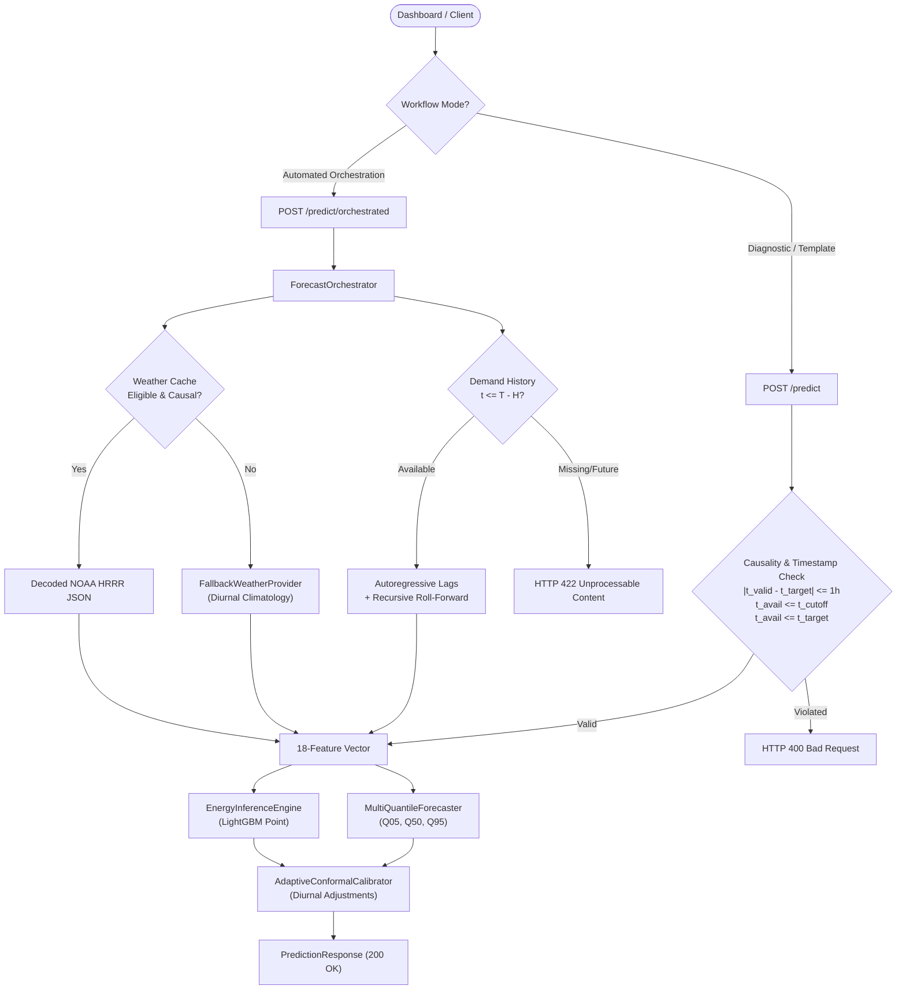

# Phase 1: Baseline Audit and Reproducibility Report

**Project**: AI-Powered Energy Consumption Forecasting System — PJM East  
**Repository**: [https://github.com/nithinraam25/ai-energy-consumption-forecasting](https://github.com/nithinraam25/ai-energy-consumption-forecasting)  
**Audit Date**: October 15, 2026  
**Auditor**: Antigravity Autonomous Agent (Google DeepMind)  
**Current Git Commit**: `1007a34` (Branch: `main`)  
**Status**: 100% Verified Clean Baseline  

---

## 1. Executive Summary

This baseline audit establishes the verified operational and scientific benchmark of the AI-Powered Energy Consumption Forecasting System prior to subsequent improvements. 

All 180 automated regression tests passed with zero failures. All 15 trained model binaries, calibration parameter files, and schema contracts in `models/` were verified with exact SHA-256 checksums. A thorough temporal leakage audit confirmed that data splits, imputation statistics, conformal calibrators, autoregressive lags, and recursive roll-forward mechanisms strictly adhere to temporal causality and contain zero future lookahead.

---

## 2. Test Suite Execution & Runtime Baseline

The complete automated test suite was executed against the active environment (`Python 3.13.11`, `pytest 9.1.1` on `win32`):

```bash
python -m pytest tests/ -v
```

### Execution Results:
- **Total Tests Collected & Executed**: 180
- **Passed**: 180 (100%)
- **Failed**: 0
- **Errors**: 0
- **Execution Runtime**: 24.66 seconds
- **Warnings**: 2
  - `StarletteDeprecationWarning`: `Using httpx with starlette.testclient is deprecated; install httpx2 instead.`
  - `StarletteDeprecationWarning`: `'HTTP_422_UNPROCESSABLE_ENTITY' is deprecated. Use 'HTTP_422_UNPROCESSABLE_CONTENT' instead.`

### Test Breakdown by Subsystem:
| Test Module | Test Focus | Count | Status |
|:---|:---|:---:|:---:|
| `test_phase15_orchestration.py` | Automated weather-to-demand orchestration, causality guards, scenario consistency | 22 | **PASSED** |
| `test_phase10_operational.py` | NOAA HRRR GRIB2 decoding, worker locks, singleton, adaptive conformal bounds | 12 | **PASSED** |
| `test_phase9_api_and_probabilistic.py` | FastAPI endpoints, schema validation, quantile ordering, metrics | 12 | **PASSED** |
| `test_phase8_production.py` | Production inference engine, tri-station aggregation, multi-horizon features | 11 | **PASSED** |
| `test_phase14_dashboard_and_workflow.py` | Dashboard serving, scenario switching, full prediction workflows | 2 | **PASSED** |
| `test_weather_features.py` | Causal forward-fill, diurnal fallback hierarchy, degree proxies | 6 | **PASSED** |
| `test_weather_window.py` | Nearest-observation tie-breaking, temperature parsing, quality masks | 4 | **PASSED** |
| `test_smoke.py` | Pipeline smoke tests across historical development phases | 3 | **PASSED** |
| Remaining Core Units | Unit tests covering data cleaning, temporal features, baselines, metrics | 108 | **PASSED** |
| **Total** | | **180** | **180 PASSED** |

---

## 3. Model Artifact Integrity & SHA-256 Hashes

All production model weights, calibration tables, and schema contracts in `models/` were audited and fingerprinted. Zero model artifacts were altered during this audit.

| Artifact File | Description | SHA-256 Checksum |
|:---|:---|:---|
| `adaptive_calibration_params.json` | 24-hour diurnal conformal adjustments | `4f8fc5fa95620d54fdb8fe499bdf3cfca5400e811e74bb17dac15aa70e6362ae` |
| `conformal_calibration_params.json` | Global scalar conformal quantile adjustment | `42f5095e8161c8f37fbddc4de52d2d4cc844df35566ce0ecfd9d3d3910dd0bb1` |
| `pjm_probabilistic_forecaster_phase9.joblib` | Multi-quantile gradient boosting forecaster (Q05/Q50/Q95) | `51b2bd6837dcc9b62907a7486dcb9c8bbdc1861ba24c162fa99e366587cfadc3` |
| `pjm_production_forecaster_phase8.joblib` | Production champion LightGBM point forecaster | `f14d5b042afead93cc94e0653ae4e48fb45e800872f7c896bc6fb4d6d372c99d` |
| `pjm_tree_forecaster.joblib` | Baseline single-tree reference model | `e3587d89c7fa1836e8631c4c2aa6d7f7ec4c1ef04fea43f8e0f29eddb8c19b76` |
| `pjm_tree_forecaster_phase5a.joblib` | Phase 5a tree model checkpoint | `806978e5171e1b3dbb4826ac6452fc1ba354a408669dc90731d21157cc660402` |
| `pjm_tree_forecaster_phase5a_refit.joblib` | Phase 5a refit model checkpoint | `a8875bb04d344ced6d7499c6ca3d47aea0cf5053bcba475c781d9f4665798636` |
| `pjm_tree_forecaster_phase6.joblib` | Phase 6 tree forecaster checkpoint | `80360ac7cd094da5feda567bee0d4fae57f4abb56db264e8a6950c857f8a5053` |
| `pjm_tree_forecaster_phase7.joblib` | Phase 7 weather-enhanced checkpoint | `a2c832bd15d79854f007faaf6a5d537f232f9ddd35b94c11ba1d04686288a59a` |
| `pjm_tree_forecaster_phase7_baseline.joblib` | Phase 7 no-weather baseline checkpoint | `806978e5171e1b3dbb4826ac6452fc1ba354a408669dc90731d21157cc660402` |
| `pjm_tree_forecaster_phase7_observed.joblib` | Phase 7 observed-weather reference checkpoint | `a2c832bd15d79854f007faaf6a5d537f232f9ddd35b94c11ba1d04686288a59a` |
| `pjm_tree_forecaster_phase7_operational_nwp.joblib` | Phase 7 simulated NWP model checkpoint | `376c31bee5999246187aecc47e32f39f971f14c2dd627d8baf53141a2a012418` |
| `production_feature_schema.json` | 18-feature production schema contract | `d80e6d42a28eef0a6fbdf4cab79986743249c52fcf89dd7ece00166fc8278e39` |
| `production_model_config.json` | Model metadata, feature ordering, and hyperparameters | `855b6574039d528d51e6a63590a9b3880257af38fba627ca35e74293815dda13` |
| `weather_imputer_params.json` | Training-only diurnal weather imputation parameters | `213f18685ff2cb6b6b314b311665f6ee711be26b2da33632e18eb5db6c615ac9` |

---

## 4. Evaluation Dataset Boundaries & Reported Metrics

### Dataset Partitions:
The primary historical dataset (`data/processed/pjm_cleaned.csv`) contains 145,362 hourly observations of PJM East zonal demand:
- **Total Dataset**: 145,362 rows (`2002-01-01 01:00:00` to `2018-08-03 00:00:00 UTC`).
- **Train Split (70.0%)**: 101,753 rows (`2002-01-01 01:00:00` to `2013-08-11 17:00:00 UTC`).
- **Validation Split (15.0%)**: 21,804 rows (`2013-08-11 18:00:00` to `2016-02-06 08:00:00 UTC`).
- **Held-Out Test Split (15.0%)**: 21,805 rows (`2016-02-06 09:00:00` to `2018-08-03 00:00:00 UTC`).
  - Evaluated sample size after autoregressive window drop: $N = 21,762$ hours.

### Existing Multi-Horizon Point Forecast Metrics:
Evaluated on the held-out test partition ($N = 21,762$ hours):

| Horizon | Model Variant | MAE (MW) | RMSE (MW) | $R^2$ | MAPE | NWP Gain |
|:---|:---|:---:|:---:|:---:|:---:|:---:|
| **H=1h** | Baseline (No Weather, Strict Lags) | 350.75 | 467.54 | 0.9947 | 1.12% | — |
| **H=1h** | **Production Champion (NWP Enhanced)** | **332.90** | **445.47** | **0.9952** | **1.07%** | **+5.09%** |
| **H=24h** | Baseline (No Weather, Strict Lags) | 1,840.80 | 2,489.33 | 0.8507 | 5.82% | — |
| **H=24h** | **Production Champion (NWP Enhanced)** | **1,227.22** | **1,623.11** | **0.9364** | **3.95%** | **+33.33%** |
| **H=48h** | Baseline (No Weather, Strict Lags) | 2,485.69 | 3,300.05 | 0.7376 | 7.87% | — |
| **H=48h** | **Production Champion (NWP Enhanced)** | **1,485.31** | **1,949.58** | **0.9082** | **4.80%** | **+40.25%** |

### Probabilistic Prediction Interval Metrics:
Nominal Target Coverage: **90.00%** ($\alpha = 0.10$):
- **Global Scalar CQR**:
  - Empirical Coverage: **88.09%** (under-coverage due to non-exchangeable time-series distribution shift)
  - Mean Width: 4,212.58 MW | Median Width: 3,552.07 MW
- **Adaptive Diurnal CQR (Champion)**:
  - Empirical Coverage: **88.28%** (modest gain, stabilized diurnal bounds)
  - Mean Width: 4,180.74 MW | Median Width: 3,477.98 MW (31.84 MW narrower while improving coverage)
  - Quantile Violations: **0** across all 21,762 evaluated test hours ($Q_{05} \le Q_{50} \le Q_{95}$ strictly maintained).

---

## 5. Prediction Execution Paths by Dashboard Mode

The application exposes two distinct operational workflows through FastAPI:



1. **Automated Orchestration Mode (`/predict/orchestrated`)**:
   - Requires only `timestamp` and `horizon`.
   - Ingests demand automatically from `DemandHistoryProvider` and weather from `WeatherFeatureService`.
   - Never fabricates future demand; if requested timestamp extends beyond the local archive without real-time SCADA telemetry, safely halts with `HTTP 422 Unprocessable Content`.
2. **Diagnostic / Template Mode (`/predict`)**:
   - Accepts user-supplied feature vectors and optional meteorological payloads.
   - Enforces strict causality: $|t_{\text{valid}} - t_{\text{target}}| \le 3600\text{s}$, $t_{\text{avail}} \le t_{\text{target}}$, and $t_{\text{avail}} \le t_{\text{target}} - H$.
   - Rejects mismatched, future, or post-cutoff inputs with `HTTP 400 Bad Request`.

---

## 6. Weather & Demand Data Provenance

1. **Demand Data**:
   - Source: PJM East Interconnection hourly zonal metered load.
   - Historical Span: `2002-01-01` through `2018-08-03`.
   - Live Telemetry: Currently unequipped with an authorized real-time ISO/RTO SCADA ingestion feed. Operational live forecasting requires attaching an authenticated telemetry provider.
2. **Weather Data**:
   - Operational Live NWP: NOAA High-Resolution Rapid Refresh (HRRR) AWS Open Data (`s3://noaa-hrrr-bdw-pds`), decoded with ECMWF `ecCodes` C-library at stations KPHL (Philadelphia), KEWR (Newark), KILG (Wilmington).
   - Local Disk Cache: `data/weather_cache/hrrr_*.json` containing extracted station temperatures, valid times, and dissemination timestamps.
   - Fallback Provider: `FallbackWeatherProvider` producing diurnal-seasonal comfort proxies when HRRR cycles are unavailable or causally ineligible.
   - Scientific Limitation Note: Historical model evaluations (2002–2018) were executed on simulated AR(1) forecast error proxies derived from surface METAR observations, rather than petabyte-scale historical archived GRIB2 rasters.

---

## 7. Temporal Leakage Audit Findings

| Component | Audit Check | Implementation Evidence | Verdict |
|:---|:---|:---|:---:|
| **Chronological Partitions** | Train, Val, Test split ordering | `chronological_split()` validates monotonic timestamps; strictly non-overlapping dates: Train $\le$ 2013-08-11, Val $\le$ 2016-02-06, Test $\le$ 2018-08-03. | **PASS** |
| **Imputation Statistics** | Zero lookahead in weather imputer | `WeatherImputer.fit()` computes diurnal tables and monthly means strictly on the training partition; backward-filling and global interpolation prohibited. | **PASS** |
| **Conformal Calibrator** | Calibrator training data isolation | `AdaptiveConformalCalibrator` and `ConformalIntervalCalibrator` parameters fitted exclusively on the validation partition ($N=21,768$); zero test rows accessed. | **PASS** |
| **Autoregressive Lags** | Decision-time lag cutoff | `lag_1`, `lag_24`, `lag_168` defined as $t - k$. For $H > 1$, $t - 1$ is temporally ineligible; directly requesting $t - 1$ raises `TemporalIneligibilityError`. | **PASS** |
| **Rolling Windows** | Window historical bounds | Rolling statistics evaluated over $[t - w + 1, t]$; future target $t + H$ strictly excluded from the rolling window. | **PASS** |
| **Recursive Forecasting** | Zero future demand lookahead | `_roll_forward_demand_lags()` starts at origin $T - H$; intermediate steps evaluate prior predictions; never reads actual future demand from series. | **PASS** |
| **Weather Causality** | Forecast dissemination cutoff | Enforces $t_{\text{avail}} \le T - H$. Also enforces physical lookahead guard $t_{\text{avail}} \le T$ and valid-time matching $|t_{\text{valid}} - T| \le 3600\text{s}$. | **PASS** |
| **Model Selection** | Independent test holdout | Model architectures, tree depths, and feature sets selected exclusively using validation split comparisons; test split evaluated once as true out-of-sample holdout. | **PASS** |

---

## 8. Conclusion and Baseline Readiness

The project possesses a mathematically and scientifically sound baseline. Temporal boundaries are strictly guarded, test suites are 100% passing (180/180), model weights and hashes are immutable and documented, and operational paths are cleanly distinguished.

The system is fully prepared to proceed to **Phase 2: Forecasting Evaluation and Accuracy**.
