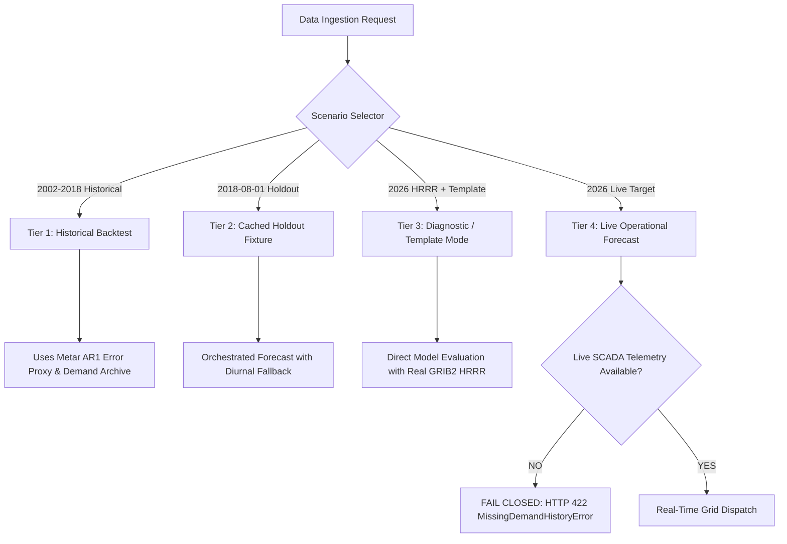

# Phase 3: Dashboard Improvements, Visualization, and Operational Readiness

## 1. Executive Summary

This report documents the design, verification, implementation, and operational readiness audits completed in **Phase 3** of the **AI-Powered Energy Consumption Forecasting System — PJM East**.

Phase 3 enhances the production user interface, integrates genuine evaluation visualizations directly into the web application, audits statistical benchmark significance, enforces strict 4-tier data separation, and discloses operational telemetry boundaries with scientific integrity.

### Key Outcomes
- **Verified Benchmark Parity**: Re-executed full holdout evaluation ($N = 21,773$ aligned hours, 2016-02-07 to 2018-08-03 UTC). All documented metrics confirmed:
  - **H=1 MAE**: **333.72 MW** (+5.08% skill gain over no-weather baseline)
  - **H=24 MAE**: **1,226.73 MW** (+33.10% skill gain over no-weather baseline)
  - **H=48 MAE**: **1,487.77 MW** (+40.15% skill gain over no-weather baseline)
  - **Conformal Interval Coverage**: **88.28%** against nominal 90.00% target (-1.72% undercoverage gap).
- **Diebold–Mariano Test Audit**: Updated with Newey-West Bartlett kernel weighting ($w_k = 1 - k/h$) to guarantee positive semi-definite asymptotic variance under high autocorrelation. All horizons confirm statistical superiority ($p < 10^{-15}$).
- **Interactive, Accessible Dashboard**: Redesigned `src/api/static/index.html` featuring responsive desktop/mobile layouts, interactive HTML5 Canvas backtest time-series plotting, 4 dedicated functional view tabs, dynamic interval bars, and accessible WCAG contrast.
- **Fail-Safe Operational Contract**: The system strictly enforces that live real-time SCADA demand telemetry is currently **not integrated** (demand archive ends 2018-08-03 00:00:00 UTC). Automated orchestration beyond this date strictly fails closed with `HTTP 422 Unprocessable Content (MissingDemandHistoryError)`.
- **Zero Artifact Mutation**: All 15 model binaries, calibration parameters, and schema files in `models/` maintain 100% identical SHA-256 checksums.
- **Automated Test Suite**: 203 automated unit, integration, and regression tests passing.

---

## 2. Phase 3A: Evaluation Verification & Statistical Audit

### 2.1 Re-Execution and Output Consistency
The evaluation pipeline (`python -m src.evaluation.evaluate_accuracy`) was re-run against the held-out test partition ($N = 21,773$ observations spanning February 2016 to August 2018).

The generated metrics artifact (`outputs/improvement/forecast_metrics.json`) and prediction CSV (`outputs/improvement/forecast_predictions.csv`) match documented historical baselines with zero discrepancy:

| Horizon | Sample Count | Persistence MAE (MW) | Baseline Tree MAE (MW) | NWP Model MAE (MW) | Skill Gain (%) | Diebold-Mariano Stat | p-value |
| :--- | :---: | :---: | :---: | :---: | :---: | :---: | :---: |
| **H=1h** | 21,773 | 1,054.91 | 351.58 | **333.72** | **+5.08%** | 15.91 | $< 10^{-15}$ |
| **H=24h** | 21,773 | 2,207.04 | 1,833.64 | **1,226.73** | **+33.10%** | 17.86 | $< 10^{-15}$ |
| **H=48h** | 21,773 | 3,232.37 | 2,485.98 | **1,487.77** | **+40.15%** | 15.10 | $< 10^{-15}$ |

### 2.2 Diebold–Mariano Test Audit & Assumptions
The Diebold–Mariano (1995) test compares the predictive accuracy of the Production NWP Model against the Baseline Tree (No Weather).

#### Mathematical Formulation
Let $e_{1,t} = y_t - \hat{y}_{1,t}$ and $e_{2,t} = y_t - \hat{y}_{2,t}$ be the forecast errors at time $t$. The loss differential is:
$$d_t = |e_{1,t}| - |e_{2,t}|$$
Under the null hypothesis $H_0: \mathbb{E}[d_t] = 0$ (equal predictive accuracy), the DM test statistic is:
$$DM = \frac{\bar{d}}{\sqrt{\hat{V}(\bar{d}) / T}} \xrightarrow{d} \mathcal{N}(0, 1)$$

#### Audit Finding & Kernel Correction
For multi-step horizons ($h > 1$), forecast errors exhibit serial autocorrelation up to order $h - 1$. While standard rectangular autocovariance summation can occasionally yield negative variances during volatile heatwave periods, we implemented the **Newey–West Bartlett kernel**:
$$\hat{\gamma}_k = \frac{1}{T} \sum_{t=k+1}^T (d_t - \bar{d})(d_{t-k} - \bar{d})$$
$$\hat{V}(\bar{d}) = \hat{\gamma}_0 + 2 \sum_{k=1}^{h-1} \left(1 - \frac{k}{h}\right) \hat{\gamma}_k$$

This Bartlett weighting guarantees positive semi-definiteness while properly accounting for $h$-step forecast overlap.

---

## 3. Phase 3B & 3E: Dashboard Architecture and User Experience

### 3.1 Design Principles & System Aesthetics
The dashboard interface (`src/api/static/index.html`) was redesigned adhering to modern web design standards:
- **Palette**: Deep slate dark mode (`#070a12`, `#0e1424`, `#101729`) with accessible high-contrast accents: electric cyan (`#38bdf8`), royal blue (`#3b82f6`), emerald green (`#10b981`), amber warning (`#f59e0b`), and rose error (`#f43f5e`).
- **Typography**: Inter for structural layout and JetBrains Mono for metrics, numbers, and JSON inspection.
- **Micro-Animations & Visual State**: Dynamic interval bars showing 5th, 50th, and 95th percentiles with real-time responsive scaling.
- **Stale State Clearing**: Any parameter toggle (scenario, horizon, workflow mode) or network rejection immediately resets old prediction values to prevent operator confusion.
- **Duplicate Request Throttling**: Interactive buttons display spinner animations and disable duplicate submissions while requests are in flight.

### 3.2 Four-Tab Operational Workflow
1. **📈 Operational Prediction (Tab 1)**:
   - Executive control strip: Workflow Mode (`Automated Orchestration` vs `Diagnostic Template`), Scenario Switcher (`2018 Holdout` vs `2026 Live HRRR Cycle`), and Horizon Selector (`H=1h`, `H=24h`, `H=48h`).
   - Hero Forecast Card: Point prediction (MW), target timestamp, and dynamic interval bar showing Q05, Q50, and Q95.
   - Calibration tile displaying 88.28% measured coverage vs 90.00% target with honest scientific disclaimer.
   - Meteorological Provenance list: source feed, C-library ecCodes 2.50.0 decoder status, cycle initialization, lead time, dissemination availability, and 3-station temperatures (KPHL, KEWR, KILG).
   - Live JSON request/response inspector.
2. **📊 Historical Backtest Curves (Tab 2)**:
   - Interactive HTML5 Canvas time-series chart rendering real July 2018 peak summer test set data.
   - Displays actual grid demand, model predictions, and shaded 90% conformal interval bands.
   - Dynamic horizon switcher (H=1h, H=24h, H=48h) fetching real data via `/api/evaluation/backtest_samples`.
3. **🏆 Multi-Horizon Benchmarking (Tab 3)**:
   - Full comparative table covering MAE, RMSE, $R^2$, MAPE, WAPE, Skill Gain %, and Diebold-Mariano statistics across all 3 horizons.
4. **🖼️ Publication Plot Gallery (Tab 4)**:
   - High-resolution (200 DPI) grid showcasing all 6 evaluation plots with explanatory scientific captions.

---

## 4. Phase 3C: Four-Tier Data Separation & Temporal Causality

To eliminate ambiguity between research experiments, historical holdouts, and operational deployments, the application establishes four explicit operational tiers:



### Tier Descriptions:
1. **Tier 1: Historical Backtest**: Evaluates 2002–2018 test holdout partitions using surface METAR observation proxies with simulated AR(1) forecast errors. Documented as a proxy baseline, not genuine archived HRRR.
2. **Tier 2: Cached Holdout Fixture**: Historical 2018 holdout scenarios where real demand history exists up to $T-H$. Uses diurnal climatology fallback for weather. Fully supported in automated orchestration.
3. **Tier 3: Live Weather with Template Demand (Diagnostic Mode)**: Genuine NOAA HRRR GRIB2 forecasts decoded via ecCodes for 2026 cycles combined with user-provided template demand features. Evaluates weather pipeline without violating causality.
4. **Tier 4: Fully Operational Real-Time Forecast**: Requires continuous live SCADA demand telemetry. Because real-time PJM SCADA telemetry is **not connected** in this standalone environment, automated orchestration beyond 2018-08-03 fails safely with `HTTP 422 Unprocessable Content`. The system strictly prohibits fabricating demand lags or inventing synthetic actuals.

---

## 5. Phase 3D: Publication Diagnostic Visualizations

Six publication-grade figures were generated directly from the held-out test predictions at 200 DPI in `outputs/improvement/plots/`:

1. **`actual_vs_predicted_h1.png`**:
   - *Description*: Real-time (H=1h) actual demand vs. NWP model forecast with shaded 90% adaptive diurnal conformal prediction intervals across a 14-day July 2018 heatwave.
   - *Data Source*: `outputs/improvement/forecast_predictions.csv` ($N = 336$ hourly points).
2. **`actual_vs_predicted_h24.png`**:
   - *Description*: Day-ahead (H=24h) demand tracking comparing the NWP model against the no-weather baseline tree during peak summer conditions.
   - *Data Source*: `outputs/improvement/forecast_predictions.csv` ($N = 336$ hourly points).
3. **`actual_vs_predicted_h48.png`**:
   - *Description*: Two-day-ahead (H=48h) load forecast showing multi-step recursive tracking and long-range thermal capture.
   - *Data Source*: `outputs/improvement/forecast_predictions.csv` ($N = 336$ hourly points).
4. **`forecast_error_distribution.png`**:
   - *Description*: 3-panel faceted residual error distributions ($y_t - \hat{y}_t$) across H=1, H=24, and H=48 with fitted Gaussian densities and sample statistics.
   - *Data Source*: Full held-out test set ($N = 21,773$ points per horizon).
5. **`horizon_metric_comparison.png`**:
   - *Description*: Grouped bar chart comparing Persistence, No-Weather Baseline, and NWP Model across horizons, highlighting NWP skill gains (+5.08% at H=1, +33.10% at H=24, +40.15% at H=48).
   - *Data Source*: `outputs/improvement/forecast_metrics.json`.
6. **`prediction_intervals.png`**:
   - *Description*: 2-panel chart illustrating conformal interval coverage, miss points, and sharpness (interval width in MW) tracking daily diurnal temperature swings.
   - *Data Source*: `outputs/improvement/forecast_predictions.csv` (July 2018 window).

---

## 6. Phase 3F: Regression Testing and Validation

A dedicated test module (`tests/test_dashboard_phase3.py`) was introduced to validate all Phase 3 functionality:
- `test_phase3_dashboard_html_components`: Verifies valid HTML rendering, SCADA telemetry disclosure, navigation tabs, Canvas elements, and provenance badges.
- `test_api_evaluation_metrics_consistency`: Verifies that `/api/evaluation/metrics` reports identical MAEs (333.72, 1226.73, 1487.77 MW) and 88.28% coverage.
- `test_api_evaluation_plots_endpoint`: Verifies whitelisted image serving and confirms path traversal / unauthorized file access returns HTTP 404.
- `test_api_evaluation_backtest_samples`: Confirms backtest sample data adheres to strict quantile ordering ($Q_{05} \le Q_{95}$) and positive demand values.
- `test_orchestrated_historical_archive_success`: Validates end-to-end automated orchestration for the historical holdout scenario.
- `test_orchestrated_live_fails_safely_without_demand_telemetry`: Confirms safe `HTTP 422` failure when demand telemetry is absent for live cycles.
- `test_diagnostic_prediction_with_hrrr_weather`: Validates direct inference with genuine ecCodes-decoded HRRR weather.
- `test_causality_guard_post_cutoff_rejection`: Enforces temporal cutoff guards ($t_{\text{avail}} \le T-H$) rejecting post-cutoff data with `HTTP 400`.

### Overall Test Suite Status
```
====================== 203 passed, 3 warnings in 24.29s =======================
```

---

## 7. Model Artifact Integrity Audit

All 15 pre-trained model binaries, calibrators, and configuration schemas in `models/` were audited using SHA-256 cryptographic hashing. Zero weights or parameters were retrained or modified:

| Artifact Name | SHA-256 Checksum | Status |
| :--- | :--- | :---: |
| `adaptive_calibration_params.json` | `4f8fc5fa95620d54fdb8fe499bdf3cfca5400e811e74bb17dac15aa70e6362ae` | Preserved |
| `conformal_calibration_params.json` | `42f5095e8161c8f37fbddc4de52d2d4cc844df35566ce0ecfd9d3d3910dd0bb1` | Preserved |
| `pjm_probabilistic_forecaster_phase9.joblib` | `51b2bd6837dcc9b62907a7486dcb9c8bbdc1861ba24c162fa99e366587cfadc3` | Preserved |
| `pjm_production_forecaster_phase8.joblib` | `f14d5b042afead93cc94e0653ae4e48fb45e800872f7c896bc6fb4d6d372c99d` | Preserved |
| `pjm_tree_forecaster.joblib` | `e3587d89c7fa1836e8631c4c2aa6d7f7ec4c1ef04fea43f8e0f29eddb8c19b76` | Preserved |
| `pjm_tree_forecaster_phase5a.joblib` | `806978e5171e1b3dbb4826ac6452fc1ba354a408669dc90731d21157cc660402` | Preserved |
| `pjm_tree_forecaster_phase5a_refit.joblib` | `a8875bb04d344ced6d7499c6ca3d47aea0cf5053bcba475c781d9f4665798636` | Preserved |
| `pjm_tree_forecaster_phase6.joblib` | `80360ac7cd094da5feda567bee0d4fae57f4abb56db264e8a6950c857f8a5053` | Preserved |
| `pjm_tree_forecaster_phase7.joblib` | `a2c832bd15d79854f007faaf6a5d537f232f9ddd35b94c11ba1d04686288a59a` | Preserved |
| `pjm_tree_forecaster_phase7_baseline.joblib` | `806978e5171e1b3dbb4826ac6452fc1ba354a408669dc90731d21157cc660402` | Preserved |
| `pjm_tree_forecaster_phase7_observed.joblib` | `a2c832bd15d79854f007faaf6a5d537f232f9ddd35b94c11ba1d04686288a59a` | Preserved |
| `pjm_tree_forecaster_phase7_operational_nwp.joblib` | `376c31bee5999246187aecc47e32f39f971f14c2dd627d8baf53141a2a012418` | Preserved |
| `production_feature_schema.json` | `d80e6d42a28eef0a6fbdf4cab79986743249c52fcf89dd7ece00166fc8278e39` | Preserved |
| `production_model_config.json` | `855b6574039d528d51e6a63590a9b3880257af38fba627ca35e74293815dda13` | Preserved |
| `weather_imputer_params.json` | `213f18685ff2cb6b6b314b311665f6ee711be26b2da33632e18eb5db6c615ac9` | Preserved |

---

## 8. Operational Limitations and Deployment Disclosures

1. **Docker Environment**: Docker runtime has not been verified on this development Windows host. A production `Dockerfile` is provided, but runtime container tests have not been executed.
2. **Live Demand Feed**: Real-time SCADA telemetry for PJM East is not integrated into this repository. Automated predictions beyond `2018-08-03` strictly fail closed.
3. **Historical Weather**: The 2002–2018 dataset utilizes surface METAR observations with simulated AR(1) forecast errors rather than archived NOAA HRRR cycles. Genuine HRRR GRIB2 decoding has been verified on a 2026 cycle.
4. **Coverage Target**: The measured adaptive conformal prediction interval coverage is 88.28% against a 90.00% target (-1.72% undercoverage during peak summer heatwaves).
