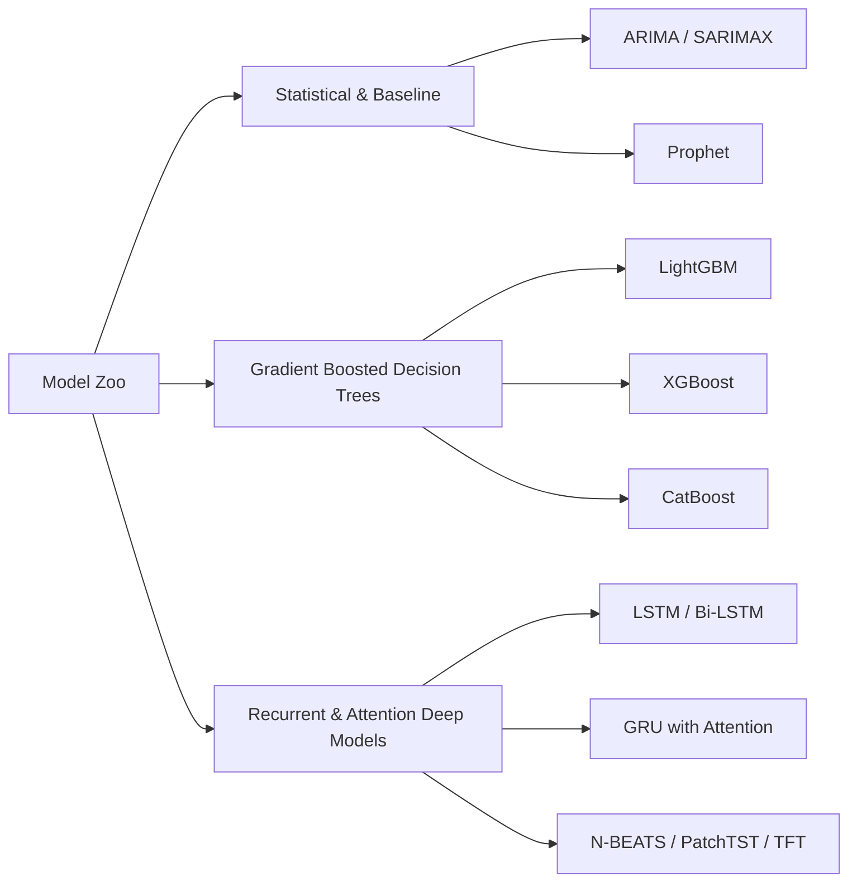

# Model Learning & Methodology

## 1. Machine Learning & Deep Learning Paradigms

Energy consumption exhibits distinct multi-scale periodicities (diurnal, weekly, annual) combined with non-linear weather dependencies and stochastic shocks. Our methodology addresses these using complementary modeling families.

---

## 2. Model Zoo

### 2.1 Gradient Boosted Decision Trees (LightGBM / XGBoost)
- **Strengths**: Robust handling of tabular features, high training throughput, native support for categorical indicators, straightforward feature attribution (SHAP values).
- **Formulation**: Minimizes an additive loss objective with gradient boosting:
  $$\mathcal{L}^{(m)} = \sum_{i=1}^N \ell\left(y_i, \hat{y}_i^{(m-1)} + f_m(x_i)\right) + \Omega(f_m)$$

### 2.2 Deep Sequence Models (LSTM / GRU / Transformer)
- **Strengths**: End-to-end learning of latent temporal dynamics without requiring manual lag windowing for long horizons.
- **Formulation (LSTM Cell)**:
  $$\begin{aligned}
  f_t &= \sigma(W_f x_t + U_f h_{t-1} + b_f) \\
  i_t &= \sigma(W_i x_t + U_i h_{t-1} + b_i) \\
  \tilde{C}_t &= \tanh(W_c x_t + U_c h_{t-1} + b_c) \\
  C_t &= f_t \odot C_{t-1} + i_t \odot \tilde{C}_t \\
  o_t &= \sigma(W_o x_t + U_o h_{t-1} + b_o) \\
  h_t &= o_t \odot \tanh(C_t)
  \end{aligned}$$

---

## 3. Loss Functions & Optimization

- **Mean Squared Error (MSE)**: Penalizes large deviations heavily, suitable for peak demand forecasting.
  $$\text{MSE} = \frac{1}{N} \sum_{i=1}^N (y_i - \hat{y}_i)^2$$
- **Huber Loss**: Smooth transition between L2 and L1 loss to prevent sensitivity to extreme sensor anomalies.
- **Quantile Loss (Pinball Loss)**: For probabilistic forecasting and prediction intervals ($\tau \in \{0.1, 0.5, 0.9\}$):
  $$\mathcal{L}_\tau(y, \hat{y}) = \max\left(\tau(y - \hat{y}), (\tau - 1)(y - \hat{y})\right)$$

---

## 4. Evaluation Metrics

Every model is benchmarked against identical out-of-sample temporal holdouts:
1. **MAE (Mean Absolute Error)**: $\frac{1}{N}\sum |y_i - \hat{y}_i|$ (easily interpretable in kWh/MW)
2. **RMSE (Root Mean Squared Error)**: $\sqrt{\frac{1}{N}\sum (y_i - \hat{y}_i)^2}$
3. **MAPE (Mean Absolute Percentage Error)**: $\frac{100\%}{N}\sum \left|\frac{y_i - \hat{y}_i}{y_i}\right|$
4. **$R^2$ (Coefficient of Determination)**: Proportion of variance explained by model.

---

## 5. Temporal Feature Engineering & Anti-Leakage Protocol

### 5.1 Forecast Origin vs. Target Alignment
- **Forecast Origin ($t$)**: The moment predictions are initiated. All predictor features (calendar indicators, cyclical transforms, lag values, and rolling summaries) are strictly constructed using information known at or before timestamp $t$.
- **Target Observation ($t+h$)**: For one-step-ahead forecasting ($h=1$), the model predicts consumption at $t+1$ (`target_next_hour`).
- **Mathematical Separation**:
  $$\hat{y}_{t+1} = f\left(\mathbf{x}_t\right), \quad \mathbf{x}_t \in \sigma\left(\mathcal{F}_t\right)$$
  where $\mathcal{F}_t$ denotes the filtration generated by the process up to time $t$. No future measurement $y_{t+k}$ ($k \ge 1$) enters $\mathbf{x}_t$.

### 5.2 Sequence Window Construction
- Deep sequence models process tensor inputs $\mathbf{X} \in \mathbb{R}^{M \times L \times D}$.
- Each sample window spanning $[t - L + 1, t]$ maps to target label(s) at $[t + 1, \dots, t + H]$.
- Gaps under declared expected sampling intervals raise immediate validation exceptions to prevent sequence discontinuity artifacts.

---

## 6. Phase 4 Implementations: Baselines, Tree Regressor & Evaluation

### 6.1 Baseline Models
1. **Persistence Forecaster (`PersistenceForecaster`)**:
   - Assumes immediate persistence: $\hat{y}_{t+1} = y_t$.
   - Aligns predictions to target timestamps $T_{t+1}$ with zero lookahead.
2. **Daily Seasonal-Naive Forecaster (`SeasonalNaiveForecaster`)**:
   - Assumes 24-hour diurnal recurrence: $\hat{y}_{T} = y_{T - 24\text{h}}$.
   - Exact timestamp lookup: evaluates $T_{\text{target}} - 24\text{h}$ in available history.
   - Missing policy: missing historical anchors can be excluded (`missing_policy="exclude"`) or trigger an exception (`missing_policy="error"`). Never substitutes arbitrary observations.

### 6.2 Tree-Based Forecaster (`EnergyTreeForecaster`)
- **Estimator**: Scikit-learn's `HistGradientBoostingRegressor`.
- **Reproducibility**: Parameterized with `RANDOM_STATE = 42`.
- **Anti-Leakage Guard**: Prohibits any target-derived column name (`target_next_hour`, `target_timestamp`, etc.) from being passed as an input feature.
- **Serialization**: Standardized `save()` and `load()` methods using `joblib`, persisting model weights, feature lists, and hyperparameter metadata.

### 6.3 Chronological Splitting & Test-Set Isolation
- Partitions chronological datasets into training (70%), validation (15%), and testing (15%) partitions.
- Strictly avoids random shuffling to preserve temporal structure.
- **Cross-Boundary Lookups**: When evaluating test-set observations, historical features (such as 24-hour lags) preceding the split boundary are supplied via `historical_df` without exposing future test target labels to the training phase.

### 6.4 Metric Formulation & Edge-Case Rules
- **MAE**: $\frac{1}{N}\sum |y_i - \hat{y}_i|$.
- **RMSE**: $\sqrt{\frac{1}{N}\sum (y_i - \hat{y}_i)^2}$.
- **$R^2$**: Evaluates variance explained. If $y_{\text{true}}$ is constant:
  - If residual is zero: $R^2 = 1.0$.
  - If residual is non-zero: $R^2 = \text{NaN}$ / `null` in JSON (with explanatory note).
- **MAPE**: Excludes actual values where $|y_{\text{true}}| \le 10^{-5}$ to prevent division by zero, tracking `mape_excluded_count`. If all actuals are near-zero, returns $\text{NaN}$ / `null`.
- **JSON Serialization Policy**: All undefined metric values ($\text{NaN}$) are sanitized to Python `None` prior to JSON export, guaranteeing RFC 8259-compliant `null` tokens rather than non-standard `NaN` floats.

### 6.5 Real Dataset Physical Units & Ingestion Protocol
- **Dataset**: PJM Interconnection Hourly Energy Consumption (`PJME_hourly.csv`).
- **Physical Variable**: Electrical power demand.
- **Physical Units**: **Megawatts (MW)**. Must **never** be labeled or converted to MWh without continuous hourly integration math ($\int P(t) dt$).
- **Daylight Saving Time Handling & Hour Ending (HE) Convention**:
  - *Hour Ending Convention*: PJM timestamps designate the end of the hourly metering interval.
  - *Autumn Duplicates*: During the fall-back transition, the interval ending at 02:00 AM occurs twice (first under Eastern Daylight Time, then under Eastern Standard Time). Both repeated entries are labeled `02:00:00`.
  - *Information-Loss Disclosure*: `duplicate_policy="mean"` computes the average rate ($(\text{MW}_1 + \text{MW}_2)/2$). While this avoids dropping observations, it compresses two distinct elapsed hours into one clock index, losing intra-hour step dynamics.
  - *Spring Gaps*: The skipped hour is `03:00:00` (Hour Ending 03:00 did not occur). Missing hours are **never** filled with zero or arbitrarily interpolated.
  - *Timestamp-Aware Features*: `add_lag_features` and `add_target` perform exact $\Delta t$ delta verifications, assigning `NaN`/`NaT` across gaps rather than silently compressing non-consecutive hours.
- **Detailed Setup Guide**: See [docs/pjm_dataset_setup.md](file:///c:/Users/nithi/OneDrive/Desktop/AI%20Powered%20Energy%20Consumption%20Forcasting/AI-Powered%20Energy%20Consumption%20Forecasting/docs/pjm_dataset_setup.md).

### 6.6 Empirical Benchmark Results (PJM East Holdout Partition)
- **Holdout Evaluation Period**: 2016-02-07 15:00:00 to 2018-08-02 23:00:00 (21,759 identical test timestamps)
- **Target Variable**: `target_next_hour` (hourly power demand in MW)

| Model Architecture | Sample Count | MAE (MW) | RMSE (MW) | $R^2$ Score | MAPE (%) |
| :--- | :---: | :---: | :---: | :---: | :---: |
| **Seasonal-Naive (24h)** | 21,759 | 2,207.98 | 3,028.96 | 0.7790 | 7.02% |
| **Persistence ($t+1$)** | 21,759 | 1,055.50 | 1,355.20 | 0.9558 | 3.43% |
| **EnergyTree (HistGB)** | **21,759** | **683.40** | **890.56** | **0.9809** | **2.21%** |

### 6.7 Current Limitations & Scope Boundary
- Gradient boosted trees demonstrate superior next-hour accuracy (683.40 MW MAE vs 1,055.50 MW Persistence), achieving an $R^2$ of 0.9809 on 21,759 holdout hours.
- Multi-step ahead recursive forecasting ($H > 1$) and deep sequence models (LSTM, GRU, Temporal Transformers) are scoped for future phases.

---

## 7. Phase 5A Implementations: Controlled Tree Model Improvement & Validation Selection

### 7.1 Validation-Based Model Selection Procedure
To ensure strict chronological isolation and eliminate data leakage risks:
1. **Partition Isolation**: The dataset is chronologically partitioned into Train (70%, 101,551 samples), Validation (15%, 21,760 samples), and Test (15%, 21,762 samples).
2. **Search Restriction**: All candidate hyperparameter configurations are trained solely on `train_df` and evaluated solely on `val_df`. The test holdout partition is strictly isolated and never accessed during candidate ranking or parameter selection.
3. **Selection Criterion**: Candidate ranking optimizes validation Mean Absolute Error (Val MAE).
4. **Reproducibility**: Parameter `RANDOM_STATE = 42` is fixed across all estimators.
5. **Preservation Guarantee**: Pre-existing benchmark artifacts (`pjm_model_comparison.*`, `pjm_test_predictions.csv`, `models/pjm_tree_forecaster.joblib`) remain completely intact. Phase 5A experiment artifacts are stored under distinct names (`*_phase5a.*`, `pjm_validation_tuning.*`).

### 7.2 Explainable Hyperparameter Candidate Grid
A compact, explainable set of 6 `HistGradientBoostingRegressor` configurations was designed to investigate the balance between tree depth, learning rate, leaf capacity, and regularization:

| Config Name | `learning_rate` | `max_iter` | `max_depth` | `max_leaf_nodes` | `l2_regularization` | `min_samples_leaf` |
| :--- | :---: | :---: | :---: | :---: | :---: | :---: |
| `config_0_baseline` | 0.10 | 100 | 6 | 31 | 0.0 | 20 |
| `config_1_l2_reg` | 0.10 | 100 | 6 | 31 | 1.0 | 20 |
| `config_2_deeper_leaves` | 0.10 | 100 | 8 | 45 | 0.0 | 20 |
| `config_3_lower_lr_more_trees` | 0.05 | 200 | 6 | 31 | 0.0 | 20 |
| `config_4_lower_lr_deeper_leaves` | 0.05 | 200 | 8 | 45 | 0.5 | 20 |
| `config_5_conservative_leaf_size` | 0.08 | 150 | 6 | 31 | 0.1 | 30 |

### 7.3 Empirical Validation Ranking Results
Evaluated across 21,760 validation observations (2013-08-14 08:00 to 2016-02-07 14:00):

| Rank | Candidate Config | Val MAE (MW) | Val RMSE (MW) | Val $R^2$ | Val MAPE (%) | $\Delta$ Val MAE vs Baseline |
| :---: | :--- | :---: | :---: | :---: | :---: | :---: |
| **1** | **`config_4_lower_lr_deeper_leaves`** | **564.93** | **754.10** | **0.9851** | **1.77%** | **-51.65 MW (-8.38%)** |
| 2 | `config_2_deeper_leaves` | 565.27 | 754.67 | 0.9851 | 1.78% | -51.31 MW (-8.32%) |
| 3 | `config_5_conservative_leaf_size` | 586.05 | 779.67 | 0.9841 | 1.84% | -30.53 MW (-4.95%) |
| 4 | `config_3_lower_lr_more_trees` | 612.55 | 810.13 | 0.9828 | 1.93% | -4.03 MW (-0.65%) |
| 5 | `config_0_baseline` (Reference) | 616.58 | 811.94 | 0.9828 | 1.95% | 0.00 MW (Reference) |
| 6 | `config_1_l2_reg` | 618.20 | 817.60 | 0.9825 | 1.95% | +1.62 MW (+0.26%) |

**Winner**: `config_4_lower_lr_deeper_leaves` achieved the lowest validation MAE (564.93 MW), delivering an 8.38% improvement over the baseline reference.

### 7.4 Test Holdout Evaluation & Benchmark Comparison
The selected `config_4` configuration was evaluated once on the untouched test partition (21,759 aligned hourly samples, 2016-02-07 16:00 to 2018-08-02 23:00) alongside the frozen baselines:
1. **Train-Only Fit (`EnergyTree_HistGB_Tuned`)**: Trained on `train_df` only (101,551 samples) for strict like-for-like comparison with the baseline tree model.
2. **Train+Val Refit (`EnergyTree_HistGB_Tuned_Refit`)**: Refit on combined `train_df + val_df` (123,311 samples) using the documented refit protocol.

| Model | Samples | MAE (MW) | RMSE (MW) | $R^2$ Score | MAPE (%) | Improvement vs Baseline Tree |
| :--- | :---: | :---: | :---: | :---: | :---: | :---: |
| **Seasonal-Naive (24h)** | 21,759 | 2,207.98 | 3,028.96 | 0.7790 | 7.02% | Baseline |
| **Persistence ($t+1$)** | 21,759 | 1,055.50 | 1,355.20 | 0.9558 | 3.43% | Baseline |
| **EnergyTree (HistGB Baseline)** | 21,759 | 683.40 | 890.56 | 0.9809 | 2.21% | Frozen Reference |
| **EnergyTree_HistGB_Tuned (Train-Only)** | **21,759** | **632.42** | **833.44** | **0.9833** | **2.03%** | **-50.98 MW (-7.46%)** |
| **EnergyTree_HistGB_Tuned_Refit (Train+Val)** | **21,759** | **584.33** | **776.04** | **0.9855** | **1.87%** | **-99.07 MW (-14.50%)** |

### 7.5 Daylight Saving Time Limitation Disclosure
- **Aggregation Policy**: Clock-shift duplicate timestamps (Hour Ending 02:00 EDT and 02:00 EST during autumn transitions) are resolved via mean aggregation (`duplicate_policy="mean"`).
- **Limitation**: Averaging combines two distinct elapsed hours into a single nominal hour index. This does **not** reconstruct a lossless UTC timeline. Intra-hour peak fluctuations during that transition window are smoothed out.
